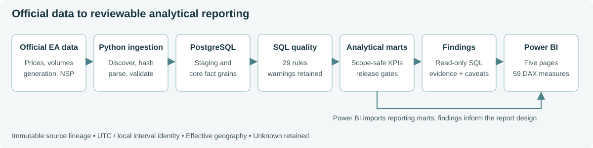

# NZ Electricity Market Analytics

**From official market data to a validated Power BI report: investigating wholesale price pressure, regional differences and the conditions associated with them.**

A national monthly average can hide local pressure and brief extremes. This SQL-led portfolio project connects a traceable PostgreSQL warehouse, explicit data-quality controls and analytical investigation to five Power BI pages for market monitoring and event review.

**Key insight:** March showed sustained price exposure; August had greater volatility, and 88 half-hours of regional pressure were absent from the National flag.

**Stack:** PostgreSQL | SQL | Power BI / DAX / Power Query | Python ingestion and validation | Docker | Git

**Scope:** September 2025-August 2026 | 37 selected publications | 17,520 half-hour intervals | 71.8M reconciled-volume fact rows. A completed local portfolio implementation; no production deployment or causal modelling is claimed.

[Read the case study](docs/portfolio_case_study.md) | [Explore all five report pages](docs/powerbi_gallery.md) | [Review the findings](docs/findings.md) | [See the architecture](docs/portfolio_architecture.md)

*Saved/reopened Power BI Desktop capture showing the full twelve-month release. Open the image for full resolution. This is the functioning report, not a wireframe.*

## What the investigation found

- **March exposure and August volatility were different problems.** March's weighted price was 152.38 NZD/MWh versus August's 82.30, while August's interval-price standard deviation was 167.53 versus March's 52.09.
- **Higher demand remained associated with pressure after comparing within month and local hour:** 6.75% above the non-pressure comparator. This does not establish causality.
- **The National P99 indicator did not capture all regional pressure:** 88 half-hours had a known Zone flagged with no National flag. Regional investigation adds information that the national average conceals.
- **A lower renewable share did not mean lower renewable output.** During pressure, renewable primary share was 89.05% versus 91.98% in the month/hour comparator, while absolute renewable output was higher.
- **Regional price separation widened during pressure:** mean known-Zone spread was 134.66 NZD/MWh versus 13.10 outside National pressure. This warrants investigation, not a conclusion of congestion.

[Full findings, methods and evidence](docs/findings.md) explain denominators, comparison groups and limitations. Pressure uses a fixed full-release P99 for each scope; it is a retrospective project definition, not an official market alert or forecast.

## What was built

- **Versioned ingestion:** immutable files, manifests, SHA-256 and idempotent reruns for prices, reconciled volumes, generation and NSP mappings.
- **SQL warehouse and marts:** source-specific grains, effective geography, DST-aware intervals, pooled price measures and separate National/Zone products.
- **Quality and investigation:** 29 SQL rules with visible warnings; event analysis, month/hour comparisons and independently checked evidence.
- **Genuine Power BI Project:** 16 loaded reporting tables, eight active single-direction relationships, 59 DAX measures and five pages, stored as PBIP + TMDL + PBIR.

The [architecture overview](docs/portfolio_architecture.md) links each layer to its implementation. [Career material](docs/career_pack.md) summarises the SQL, BI, quality and communication skills demonstrated.

## Dashboard walkthrough

| Page | Analyst question |
|---|---|
| Executive Market Monitor | Is exposure sustained, volatile or concentrated in short extremes? |
| Regional Price & Demand | Where does pressure differ from the National picture? |
| Generation Mix & Market Conditions | How do demand, absolute generation and mix compare? |
| Price Pressure Investigation | What happened within a selected event, and what is its National context? |
| Data Quality & Methodology | Which coverage gaps, classifications and source warnings affect interpretation? |

[View genuine screenshots](docs/powerbi_gallery.md) or inspect the [native Power BI Project](powerbi/NZ_Electricity_Market.pbip). E1-E5 presets, drill-through/Back and fixed-P99 date filtering were validated in Desktop. Unknown geography and Unclassified generation remain explicit.

## Validation and limitations

The retained quality assessment is **21 PASS / 8 WARN / 0 FAIL**, as of 1 October 2026. The saved regression suite records **103 passing tests**. Desktop acceptance separately passed **19 numerical checks**, **16 table row counts**, interactions and neutral save/close/reopen in **Store Desktop 2.159.883.0**. [Runtime evidence](docs/desktop_acceptance.md) | [Release validation](docs/release_validation.md)

One year does not establish long-run seasonality. Revisions, historical mapping gaps, sparse generation and classification limits remain. Listed generation is not an energy-balance identity with reconciled Offtake. No causal, predictive or commercial-impact claim is made.

Desktop-emitted PBIR visualContainer 2.14 is preserved. Its Microsoft public schema returned 404 at acceptance: available-schema validation is partial, while reference checks and actual Desktop runtime acceptance passed. This limitation is documented separately from report behaviour.

## Reproducibility and repository guide

Start with the [reproducibility guide](docs/reproducibility.md). Source code and compact validation evidence are tracked; raw publications, PostgreSQL storage, credentials and local Power BI caches are not. A clone alone does not contain a ready-to-refresh database. The guide distinguishes source restoration, database reconstruction and read-only evidence review.

| Area | Contents |
|---|---|
| [src](src/) / [sql](sql/) | Ingestion, warehouse, quality controls, marts and analysis |
| [powerbi](powerbi/) | Native project, approved queries, DAX and report definitions |
| [tests](tests/) / [outputs](outputs/) | Tests, manifests and saved validation/analytical evidence |
| [docs](docs/) | Case study, architecture, source/method documentation and technical validation |

For a technical review: [source audit](docs/source_audit.md), [KPI dictionary](docs/kpi_dictionary.md), [quality framework](docs/data_quality_framework.md), [model specification](docs/powerbi_model_spec.md). Export checks are in the [public export audit](docs/public_export_audit.md); [repository metadata and licence options](docs/repository_metadata.md) are proposed separately.
