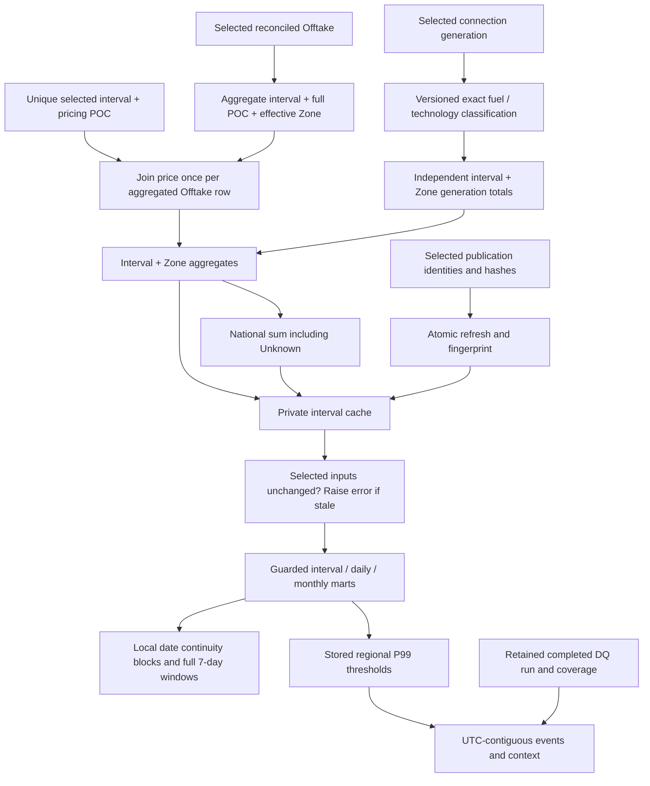

# Analytical marts and KPI design

The completed marts cover the continuous twelve-month release. National and Zone populations remain separate, fixed P99 thresholds use the full release and seven-/thirty-day windows require contiguous complete local dates. [KPI dictionary](kpi_dictionary.md) | [Release validation](release_validation.md)

## Grain and dependency boundaries

The physical warehouse is unchanged. The additive `analytics` schema is owned by `sql/04_marts/`; `sql/05_analysis/` remains reserved. The primary analytical grain is scope + Zone + interval, where scope is National or Zone and the national label is National. Never sum National and Zone rows together. National has 4,368 rows; six Zone groups including Unknown produce 26,208 rows. A daily row is scope + Zone + NZ trading date. A monthly row is scope + Zone + selected local month. Events have stable scope/Zone/start-UTC IDs within the source selection.

`queries/offtake.sql` reduces participant and network detail to interval + full POC + effective Offtake Zone. Temporary unique indexes enforce that grain and uniqueness of interval + price POC. One POC may contribute energy to more than one Zone, but each energy record contributes once. `queries/generation.sql` aggregates independently, then `queries/combine.sql` full-joins the two unique interval/Zone inputs. No price × participant × generator join exists. There is no reconciliation-versus-listed-generation balance identity.

National sums all Offtake, including Unknown geography. Geographic absence never excludes national price weights. A regional price uses the Zone already attached to the Offtake connection's effective NSP, not a guessed price-node-to-NSP bridge. Null absent-source measures remain null; measured zero remains zero. Unknown is a distinct group, not allocated to nearby or similarly named nodes.

## Price, energy and time

Prices retain exact numeric numerator `sum(price * priced Offtake kWh)` and denominator `sum(priced Offtake kWh)`. Daily, monthly and event weighted prices divide fresh sums of these components. Prices without Offtake carry no weight; unpriced Offtake remains in total demand and reduces weighting coverage. A zero priced denominator returns NULL. The signed source kWh are retained; a future negative-energy publication requires review rather than clipping. The pilot has 100% priced Offtake coverage.

Half-hour average MW is kWh / 500, and peak demand is the maximum already aggregated interval MW. Energy converts to GWh by / 1,000,000. Daily grouping uses `trading_date`, not UTC date. DST days naturally have 46/50 intervals and 23/25 hours. No energy normalisation to 24 hours occurs. UTC chronology disambiguates repeated local clock times; core retains offset, DST and fold, while marts carry interval ID plus UTC and local endpoints for joins/drill-through.

P95 and population standard deviation use interval weighted prices, with each non-null interval equally represented. They are not node-price distributions and not energy-weighted percentiles. Regional spread requires non-null prices in all five expected official NSP Zones: CNI, LNI, LSI, UNI, USI. Unknown never enters that spread; represented/expected Zone counts are returned. The configuration stores this reviewed set explicitly.

## Classification version 1

The raw 14 Fuel_Code/Tech_Code pairs are retained exactly, including case. `ref_generation_classification` has a version + exact pair PK, standard category, Primary/Storage/Unclassified role, Renewable/Fossil/Storage/Unclassified status, source URL, review status and rationale. Configuration pins version 1. A future reviewed change should add a new version through an additive migration; never rewrite applied SQL. An unseen pair falls back to Unclassified without losing its energy.

| Exact pairs | Treatment | Evidence / limitation |
|---|---|---|
| Hydro/Hydro, Wind/Wind, Solar/Solar, Wood/Cogen | Renewable primary; Hydro/Wind/Solar/Bioenergy categories | Fuel descriptors aligned to [MBIE renewable resources](https://www.mbie.govt.nz/building-and-energy/energy-and-natural-resources/energy-statistics-and-modelling/energy-statistics/renewables-statistics). Wood follows fuel rather than assuming all cogeneration is fossil. |
| Geo/Geo | Renewable primary, Geothermal | Legacy Geo/Geothermal correspondence is visible in the [EMI discussion and administrator response](https://forum.emi.ea.govt.nz/thread/changes-in-tech-codes-for-generation-md-files-causing-automation-errors/). This is documented legacy-descriptor evidence, not a complete official code dictionary. |
| Coal/Thrml, Diesel/Thrml, Gas/Thrml, Gas/Cogen | Fossil primary, Fossil thermal | [EA thermal description](https://www.ea.govt.nz/news/eye-on-electricity/the-role-of-thermal-generation/) supports the fuel categories. |
| ELE/BAT | Storage; excluded from primary generation shares | Actual observed plants are rotohiko and ruakākā_energy_park. [EA battery description](https://www.ea.govt.nz/news/eye-on-electricity/eye-on-electricity-battery-performance-in-new-zealand/) identifies both as batteries and distinguishes stored energy from new generation. This is pilot-specific plant corroboration, not a claim that the charging mix is renewable. |
| GEO/GEO, HYD/HYD, SOL/PV, WIN/ONW | Unclassified | [EA dataset metadata](https://www.emi.ea.govt.nz/Wholesale/Datasets/Generation/Generation_MD) defines the fields but the exact code legend was not confirmed. No silent case folding/abbreviation expansion. |

The original classification review on 22 September 2026 used the three pilot months and left 48.442352 / 80.182675 / 176.308674 GWh unclassified (coverage 98.627595 / 97.540646 / 95.516552%). continuous-release retains that exact-pair mapping: the full-year union has 14 pairs, with no additional pair; individual months have 13 through February and 14 thereafter. Full-year monthly classification coverage ranges from 95.516552% to 98.627595%, including reviewed storage as classified. Renewable primary share is renewable / (renewable + fossil); it excludes both storage and unclassified output. It is not the renewable share of all NZ gross electricity generation. See [original exact-pair evidence](../outputs/analytics/classification_review.json) and the current continuous-release report.

## Continuity, rolling windows and events

Interval LAG differences require current UTC start = previous UTC end. Daily LAG differences require current local date = previous date + 1. A cumulative sum starts a new date block at every gap. Windows partition by scope, Zone and date block, then order by local date; they cannot bridge missing dates or the original pilot's separate month blocks.

Seven-day measures require seven observed consecutive dates and complete demand/price interval populations on each date. Partial windows return NULL and `full_7_day_window=false`; `rolling_days` and completeness flags remain visible. Primary rolling price recombines seven-day numerator/denominator. The separately named mean-daily-price diagnostic uses `AVG() OVER` and equal day weights. Rolling demand is seven-day GWh sum. Rolling population volatility uses interval count, sum and squared sum over the same seven days, so 46/50-period days receive their actual number of interval observations; it is not standard deviation of seven daily averages. No YoY or 30-day metric is implemented.

P99 is fixed at percentile_cont(0.99), calculated independently for National and each known Zone over all 4,368 selected non-null interval weighted prices. Stored threshold rows identify population months and interval counts. First/last timestamps delimit observations, not continuous coverage. A flag means weighted price **>=** P99; ties are included, so the percentage need not be exactly 1%. This is a project statistic, not an EA official scarcity/high-price definition and not a prospective out-of-sample alarm threshold.

Event segmentation applies LAG to the full interval population before filtering flags. A new cumulative group starts after an unflagged interval or UTC gap, separately within each region. Duration is count × 0.5 hours. Endpoint local times follow UTC order, avoiding DST-fold errors. Context includes independent generation components, shares, coverage, spread coverage, retained DQ run/as-of and refresh lineage. Price rank is within-region event peak ranking for drill-through navigation, not a market-performance ranking or conclusion. Events can overlap between National and Zones and must not be summed as unique market events.

## Materialisation, freshness and execution

Measured independent Offtake aggregation took 11.321s over 17.9m reconciliation rows; generation aggregation took 0.424s. A physical interval cache and threshold cache avoid repeating those source scans. Daily, monthly, rolling and event products are ordinary views over the small cache. Recorded initial query times: daily 1.021s, rolling 1.959s, event context 1.451s. There are no new core indexes or partitions. Temporary unique indexes both enforce join grains and aid the refresh; cache indexes are only primary/unique constraints. These are local pilot measurements, not full-archive SLAs. Full `EXPLAIN (ANALYZE, BUFFERS, FORMAT JSON)` plans are in [outputs/analytics](../outputs/analytics).

The runner uses the same warehouse/DQ advisory lock and a repeatable-read transaction. It enforces exactly the approved three-source/month set and requires selected publication IDs to match the retained completed DQ assessment. It atomically replaces both caches and advances `current_refresh` only on success. Failures retain ERROR attempt metadata and roll back cache changes; the previous successful cache remains available only if its inputs are still current. No raw download, fact reload or DQ rerun is implicit.

The SHA-256 input fingerprint covers selected publication identities/content hashes, pinned configuration, exact classification rows and migration ledger hashes. Public analytical views call `assert_current()`: if selections, references or migrations change, the query raises a stale/absent error until a valid refresh. Removing a selection or changing classification is tested under rollback. `refresh_status` intentionally remains queryable to diagnose staleness. Private underscore cache tables are implementation storage, not consumer interfaces; PUBLIC access is revoked. The current local owner can bypass application conventions, so an eventual BI read-only role must receive only approved views. No application-role security boundary is claimed here.

Database fingerprinting cannot detect arbitrary manual in-place fact edits preserving lineage. Immutable warehouse loading and single-writer orchestration are the supported path. The runner also records a code SHA-256 and Git commit; compare these when changing code. Filesystem code changes become effective through the reviewed migration/refresh workflow, not by magic database file monitoring. JSON exports are immutable review snapshots, not live views; consult `export_lineage.json` and regenerate after refresh.

`mart_source_quality` and `mart_quality_results` expose the DQ assessment retained at refresh time. The archived analytical-mart assessment used 2026-09-21 and recorded 21 PASS / 8 WARN / 0 FAIL. continuous-release requires a new assessment matching the expanded selected publications; inspect its recorded as-of date and results in [continuous-release validation](release_validation.md). The three invalid NSP boundaries, history gaps, Unknown coverage, sparse generation, I/X disagreement and revision-finality limitations remain explicit.

## Unknown population diagnostic clarified on 25 September

The affected-date diagnostic means `NOT demand_day_complete OR NOT price_day_complete` for the Unknown group; it does not mean the official source file is incomplete. September 2025 has 28 such local dates: 24 with no Unknown Offtake rows and four with a partial interval population (18 September: 11/48; 20 September: 39/48; 22 September: 27/48; 23 September: 4/48). April has one: 12 April, 47/48 intervals. August has none. There are zero affected dates with present Offtake but a zero priced-energy denominator. All observed Unknown Offtake energy is priced.

Independent selected-core rows reproduce these populations. Unknown is a residual mapping group and is not required to exist on every date/TP. These observations are consistent with actual source population/mapping behaviour; they are not evidence of missing official files or missing national demand. The reason each record belongs to Unknown is not invented. Missing Unknown source measures remain NULL; generation-only Unknown intervals may still appear. The five known Zones and National separately pass all daily interval-population checks. See `unknown_dates.json` and `unknown_source_population.json` in outputs/analytics. Rolling completeness flags remain conservative eligibility diagnostics rather than DQ failures for absent Unknown demand.
