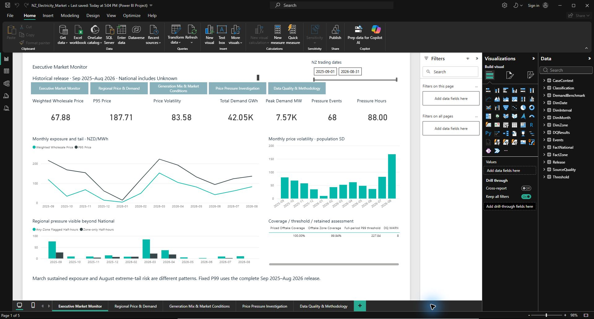
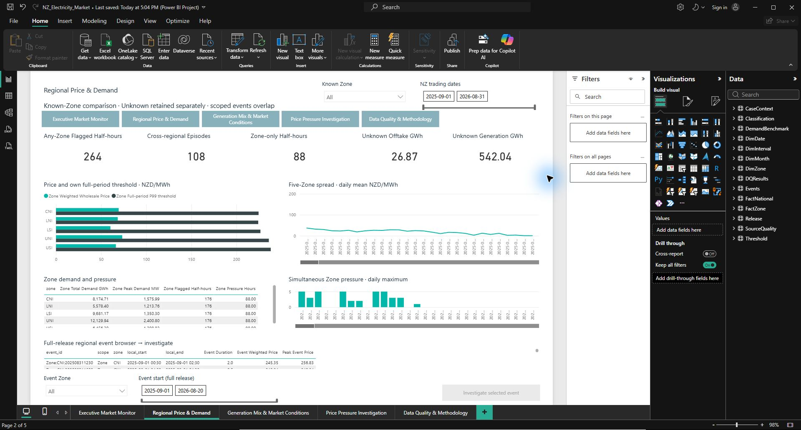
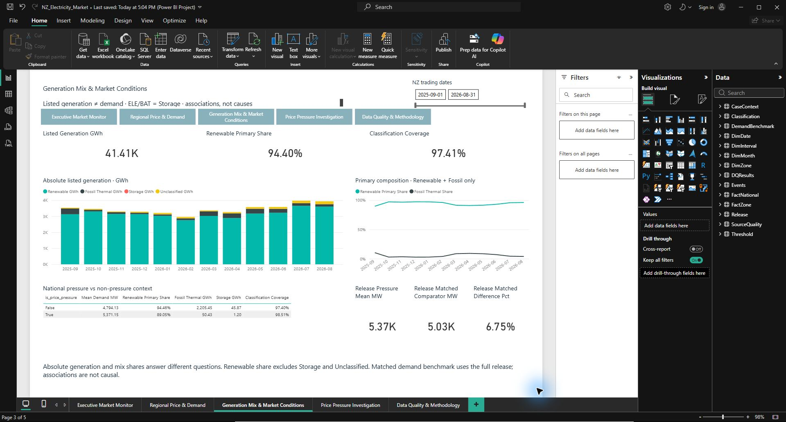
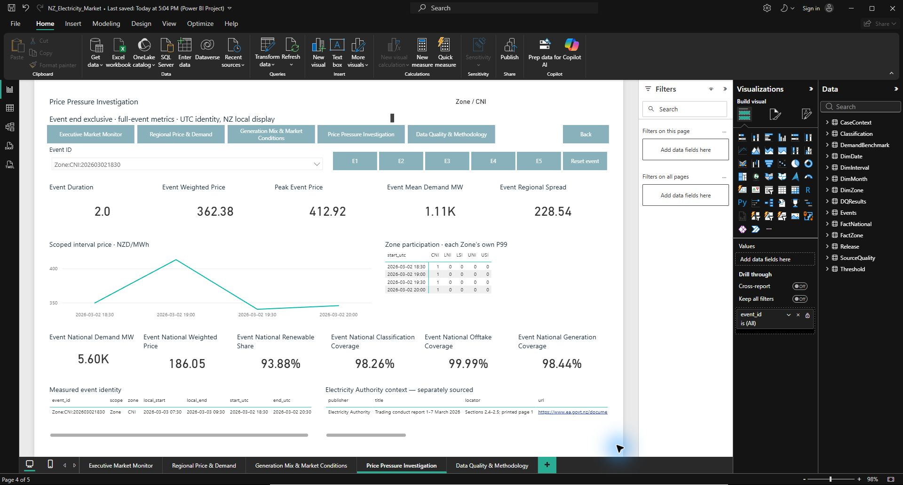
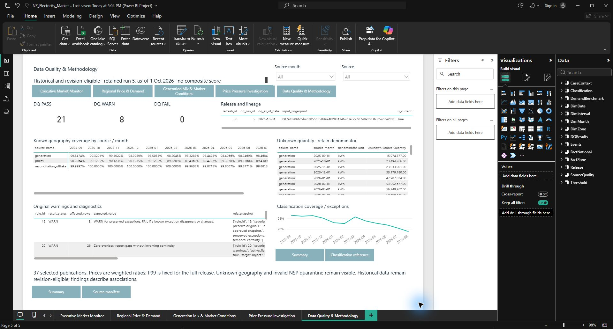

# Power BI report: genuine Desktop screenshots

These are size-reviewed, pixel-identical copies of the saved/reopened report captured during Desktop runtime acceptance in Store Desktop 2.159.883.0. They are not wireframes or regenerated visuals. Open an image at full size to read dense tables; scroll bars are part of the accepted report. Original evidence remains in ignored local storage.

## Executive Market Monitor

Monthly weighted exposure, tail prices and volatility sit alongside regional pressure and coverage. The full-release National P99 stays fixed when the date range changes.

## Regional Price & Demand

Known-Zone comparisons preserve Unknown energy separately. Any-Zone half-hours, cross-regional episodes and Zone-only half-hours answer distinct questions; they are not additive scoped event counts.

## Generation Mix & Market Conditions

Absolute listed generation and primary-generation shares are shown together. Storage and Unclassified output remain visible; the matched demand comparison is descriptive, not causal.

## Price Pressure Investigation: E3

The selected CNI event has weighted price 362.38 NZD/MWh while National weighted price is 186.05. National is not flagged. The timeline, event identity and separately sourced official context support a scoped investigation.

## Data Quality & Methodology

The retained assessment shows 21 PASS, 8 WARN and 0 FAIL, with refresh 38 / DQ run 5. The fingerprint is a release checksum, not a user or session identifier. Warnings, mapping coverage and classification limitations remain visible.

[Runtime acceptance](desktop_acceptance.md) · [Model specification](powerbi_model_spec.md) · [Portfolio case study](portfolio_case_study.md)
