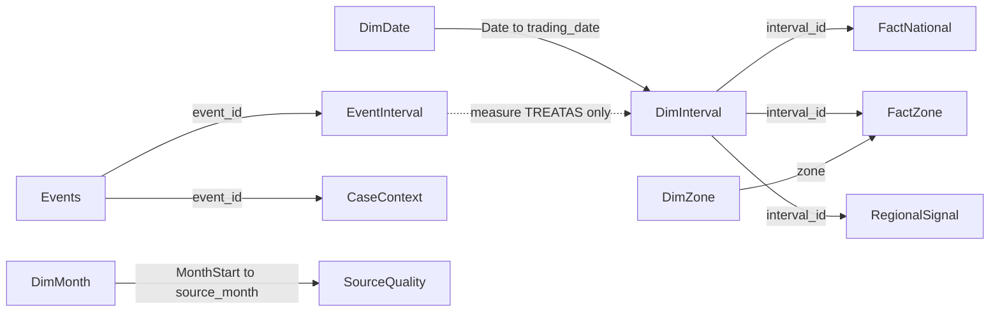

# Power BI semantic model — approved release 38

The genuine native PBIP passed Desktop runtime acceptance. See [acceptance](desktop_acceptance.md) for observed model, numerical, interaction and persistence checks.

## Source and storage

Use **Import** for every table. Approximately 105,120 Zone rows plus 17,520 National rows are sufficient; responsiveness and reproducibility matter more than DirectQuery. Use only the 13 queries in [powerbi/sql](../powerbi/sql) and their matching [Power Query inputs](../powerbi/queries). They SELECT from approved analytics views, plus the approved classification reference. No facts, staging, new database objects, migrations or refresh executions are required.

`ReleaseGate` requires refresh 38, DQ 5, current COMPLETED state and fingerprint `b87ef82066c5bcd7055d350da94b28811467c3e0c2687489fb8363c5cd6e2cf6`. The mart's own current-state assertion remains active. A changed release must fail refresh, not silently become the next report population. Power Query queries use separate connections/snapshots: keep the approved warehouse quiescent during import and recheck Release afterward; this is not a cross-table transactional refresh guarantee.

Do not import daily, monthly, rolling, spread and interval tables at overlapping fact grains. The interval tables already contain the components needed for date/day/month aggregation, P95 and population SD. Regional spread appears once in FactNational. Rolling visuals are not needed for these five pages; adding them later requires an explicit choice about full calendar windows, not simply averaging monthly ratios.

## Loaded tables

| Table | Grain / unique key | Rows | Purpose |
|---|---|---:|---|
| DimDate | NZ local trading Date | 365 | 2025-09-01–2026-08-31 inclusive; marked Date table |
| DimInterval | interval_id | 17,520 | UTC start/end, local clocks, TP, date, expected periods, offset, DST, fold |
| FactNational | interval_id | 17,520 | National weighted-price components, Offtake, generation categories, flags, complete spread |
| FactZone | zone + interval_id | 105,120 | Five known Zones **and Unknown**; never summed with National |
| DimZone | zone | 6 | Known Zones plus explicit Unknown |
| RegionalSignal | interval_id | 17,520 | All-five-known-Zone flags, Zone-only state, stable cross-regional episode identity |
| Threshold | scope + zone | 6 | Full-release National + five known-Zone P99 thresholds |
| Events | event_id | 429 | 68 National + 361 regional scoped event records, end exclusive |
| EventInterval | event_id + interval_id | 1,056 | Event membership for measure-level filtering; not an energy fact |
| CaseContext | event_id (also unique case_id) | 5 | E1–E5 selection rationale and separately labelled official context |
| DimMonth | MonthStart | 12 | Separate full-month source coverage selector |
| SourceQuality | source_name + source_month (run 5 fixed) | 36 | Geography numerator/denominator; price rows vs energy kWh |
| DQResults | rule_id (run 5 fixed) | 29 | Retained status, affected counts, original rule/diagnostic JSON |
| Release | refresh_id | 1 | DQ as-of, release fingerprint and source manifest lineage |
| Classification | classification_version + fuel_code + tech_code | 14 | Exact original pair, approved category/role and evidence |
| DemandBenchmark | one full-release comparison | 1 | Pressure-weighted same-local-month/hour comparator, fixed population |

`Source`, `ReleaseGate`, `pServer`, `pDatabase` are connection-only; disable load. There are 16 loaded tables. CaseContext is the only curated non-database evidence table; its provenance is [external_context.json](../outputs/analysis/external_context.json), reviewed 2 October 2026. It is not a live web integration. DimDate/DimMonth are deterministic calendar inputs.

The live import schema and PostgreSQL types are saved in [source_validation.json](../outputs/powerbi/source_validation.json). Use Whole Number for int4/int8, Decimal Number (not fixed decimal currency) for numeric/float8, True/False for bool, Date for date, Date/Time for timestamp and Text for text. JSON diagnostic/manifest fields are explicitly cast to Text. Preserve NULLs; do not replace Unknown missing interval quantities with zero. Do not round components before aggregation. Display rounding is separate from stored precision.

## Relationships

Create only these active **single direction, one-to-many** relationships. Force 1:* even where the current fact happens to have one row per interval, avoiding Power BI's bidirectional 1:1 default. Disable automatic relationship creation and remove any inferred links.

The machine-readable relationship contract is [relationships.json](../powerbi/relationships.json); a standalone [diagram](../powerbi/model_relationships.mmd) is also supplied. Threshold, DemandBenchmark, DQResults, Release and Classification have no relationships. Events is not related to Date, DimZone or facts. EventInterval has **no physical relationship to DimInterval**. No bridge-to-fact many-to-many or bidirectional relationship is required.

`Pressure Events` counts National events **starting on selected local dates** using TREATAS; Flagged Half-hours counts intervals within dates. They can differ for an event crossing midnight. `Cross-regional Episodes` counts full-release episode IDs intersecting visible intervals; monthly values are not additive. The 429 scoped records must never be labelled unique market-wide events.

The investigation page selects Events[event_id]. Event context measures take its EventInterval IDs, remove calendar filters and apply TREATAS to DimInterval. Scope-specific event price comes directly from Events; National demand/mix context comes from FactNational. Thus E3's CNI price is never mistaken for the National price. The event heatmap disables global Date synchronization and filters `Event Interval Visible = 1` at interval grain.

## Calendar and threshold semantics

Use [DimDate.pq](../powerbi/queries/DimDate.pq). Mark Date as the date column. Sort Month by Month Number, Year-Month by Year-Month Sort, Weekday by Weekday Number (Monday=1). Disable Auto date/time for this report. Year alone is not a full-year comparison: 2025 and 2026 here are partial calendar years.

Date is the approved local trading date, not Date.From(UTC timestamp). DimInterval UTC columns are explicitly converted to UTC-naive timestamps for VertiPaq; their names and display labels must retain UTC. Local timestamps are timezone-naive display fields. Offset (720/780 minutes), DST and fold (0/1) are separate. For detailed visuals include local_start, TP and start_utc so fall-back clocks remain distinguishable. Use start_utc to sort all interval timelines. Never make local_start a key or assume 48 TPs/day.

Threshold remains disconnected. `[Full-period P99 threshold]` explicitly selects National and ignores Threshold filters. `[Zone Full-period P99 threshold]` uses one DimZone value and stored Threshold; selecting Unknown returns blank. Neither is recomputed by Date, month, weekday, pressure flag or event filters. Label **Full-period P99 threshold · Sep 2025–Aug 2026**. Stored flags use price **>=** P99.

## Measures and field properties

[measure_catalog.json](../powerbi/measure_catalog.json) specifies every measure's expression, home table, format, display folder and description. [measures.dax](../powerbi/measures.dax) contains individually pasteable definitions. It is not one executable DAX query. National measures live in FactNational but respond to DimDate/DimInterval. Zone measures require HASONEVALUE(DimZone[zone]); totals across multiple Zones return blank by design. Axis rows establish one Zone even without a slicer.

- Hide all FactNational/FactZone columns except `is_price_pressure` (rename display caption to National/Zone pressure status). Use explicit measures for all numbers. Hide RegionalSignal raw numeric/ID columns. Never use implicit sums of prices, shares, peaks, P99 or event duration.
- Hide IDs, foreign keys, numerators and denominators, sorting columns and EventInterval entirely. Leave Events[event_id] available for drill-through and selector. Hide its numeric columns for ordinary authors; use event measures on scalar cards. For the event list use the explicit selection-safe event measures, not implicit sums.
- In DimInterval, expose trading_date/local_start/TP/start_utc/end_utc/offset/DST/fold/local_hour as detail fields, all **Don't summarize**. Hide interval_id except temporarily when constructing drill-through. Local timestamps are not hierarchies.
- All remaining numeric columns default **Don't summarize**. Measures use folders Price, Demand, Generation, Price Pressure, Regional, Coverage and Data Quality, Event Investigation; National/Zone subfolders where applicable. Percentage measures return fractions; `0.00%` format multiplies for display. Source `_pct` columns are 0–100; never format those directly as fractions.
- Set CaseContext[url] and Classification[evidence_url] data category Web URL. Treat input_manifest and diagnostics as plain text, not executable links. Keep source hashes/publication identity available in a detail table/export, not as a decorative card.

Price is SUM(price_numerator)/SUM(priced_offtake_kwh). Generation shares pool components; primary denominator is Renewable + Fossil, excluding Storage/Unclassified. Classification coverage is (listed − Unclassified)/listed. Regional spread averages only eligible complete five-Zone half-hours. P95 and population SD operate on nonblank interval prices in the current population, not pre-aggregated daily statistics. SD for one observation is explicitly zero; empty selection is blank.

## Implementation references

Microsoft documents [PostgreSQL Import and native SQL](https://learn.microsoft.com/en-us/power-query/connectors/postgresql), [PBIP text projects](https://learn.microsoft.com/en-us/power-bi/developer/projects/projects-overview), [PERCENTILEX.INC](https://learn.microsoft.com/en-us/dax/percentilex-inc-function-dax) and [STDEVX.P](https://learn.microsoft.com/en-us/dax/stdevx-p-function-dax). The model chooses Import and explicit aggregation for this project; that is a project design decision, not a platform requirement.

## Final measure review

The recovered WIP held 76 measures (the earlier handoff counted 73). Seventeen unused measures were removed; **59** remain, each exposed in a page/tooltip/title or required transitively by an exposed measure. See [measure_review.json](../powerbi/measure_review.json). Removed items include unused Zone generation measures, unused regional P95/SD, an unused regional event counter, and redundant pressure-comparison wrappers. The page designs retain all required KPIs. Use `[Event Selection Status]` as the Page 4 dynamic title; `[Zone Priced Offtake Coverage]` belongs in the regional price tooltip, and `[Spread Eligible Half-hours]` in spread tooltips.

The [reporting input contract](../outputs/powerbi/reporting_input_contract.json) records the 13 imports' query path, unique key, actual count, window, scope and refresh boundary. No model row joins National and Zone facts. All thresholds remain disconnected; the National measure removes Threshold filters and explicitly selects National, while the Zone measure obtains one Zone and explicitly applies it to stored rows. Neither expression computes a percentile. SQL reference checks verify flags against these stored thresholds across every known-Zone interval in all 12 months; this is proof of the specified/reference semantics, not a claim of an executed Desktop slicer test.
