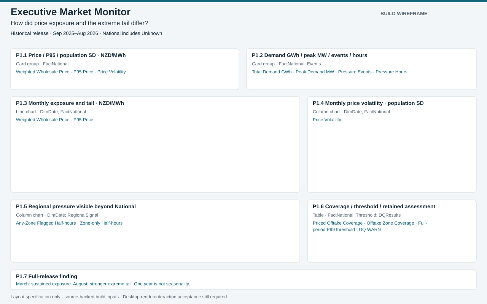
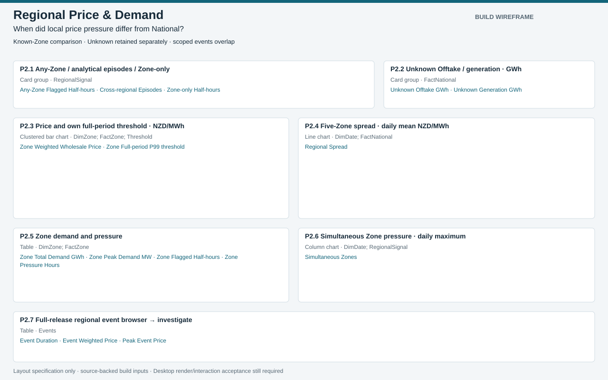
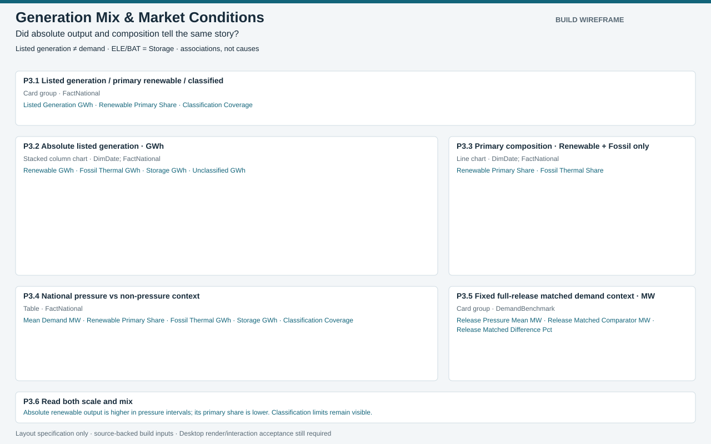
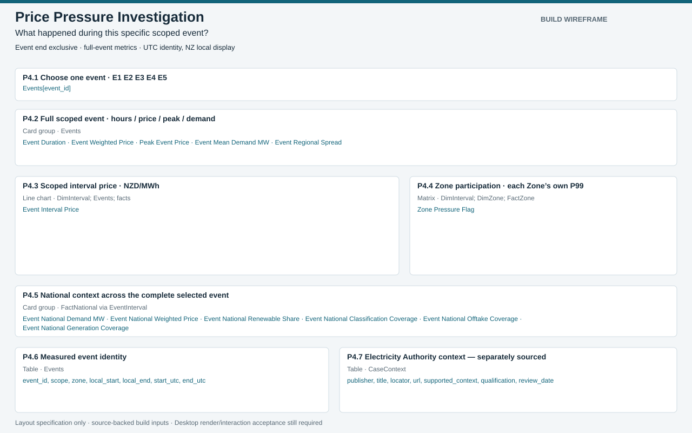
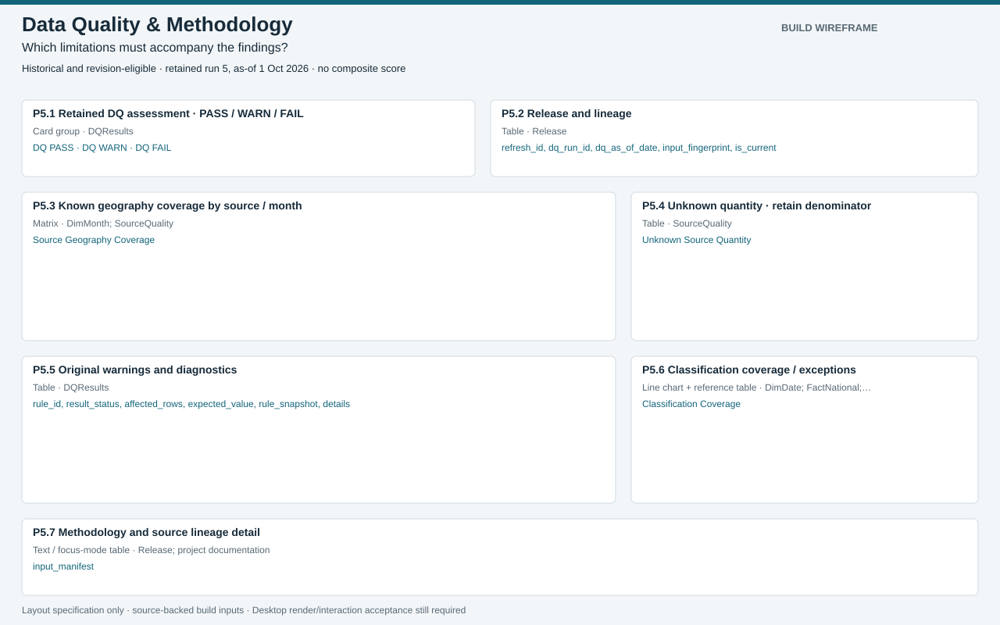

# Five-page visual register

These are construction specifications and wireframes, not screenshots of a working Power BI report. Rectangles are x/y/width/height on a 1280×800 canvas. Every measure name resolves to measure_catalog.json. See [build steps](reproducibility.md) and [interactions](powerbi_interactions.md).

## 1. Executive Market Monitor

How did price exposure and the extreme tail differ?

Historical release · Sep 2025–Aug 2026 · National includes Unknown

| ID / visual | Binding | Filters / sorting | Tooltip / interaction | Formatting / position |
|---|---|---|---|---|
| P1.1 Price / P95 / population SD · NZD/MWh; Card group | FactNational; —; [Weighted Wholesale Price], [P95 Price], [Price Volatility] | Current local Date selection; Axis ascending | Scope, units, selected dates, denominator, release 38; Date filters; chart clicks filter detail only | White card; dark text; teal; units in title; [28, 128, 600, 108] |
| P1.2 Demand GWh / peak MW / events / hours; Card group | FactNational; Events; —; [Total Demand GWh], [Peak Demand MW], [Pressure Events], [Pressure Hours] | Current local Date selection; Axis ascending | Events start on selected dates; hours are selected flagged intervals; Date filters; chart clicks filter detail only | White card; dark text; teal; units in title; [648, 128, 604, 108] |
| P1.3 Monthly exposure and tail · NZD/MWh; Line chart | DimDate; FactNational; DimDate[Year-Month]; [Weighted Wholesale Price], [P95 Price] | Current local Date selection; Axis ascending | Weighted ratio of sums; P95 of half-hours; no average of monthly averages; Date filters; chart clicks filter detail only | Solid teal exposure; dotted orange P95; one unit/axis; [28, 254, 760, 252] |
| P1.4 Monthly price volatility · population SD; Column chart | DimDate; FactNational; DimDate[Year-Month]; [Price Volatility] | Current local Date selection; Axis ascending | Scope, units, selected dates, denominator, release 38; Date filters; chart clicks filter detail only | Teal columns, zero baseline; highlight Aug with outline, not good/bad colour; [808, 254, 444, 252] |
| P1.5 Regional pressure visible beyond National; Column chart | DimDate; RegionalSignal; DimDate[Year-Month]; [Any-Zone Flagged Half-hours], [Zone-only Half-hours] | Current local Date selection; Axis ascending | Unique interval counts, not scoped event totals; known Zones only; Date filters; chart clicks filter detail only | White card; dark text; teal; units in title; [28, 526, 760, 164] |
| P1.6 Coverage / threshold / retained assessment; Table | FactNational; Threshold; DQResults; —; [Priced Offtake Coverage], [Offtake Zone Coverage], [Full-period P99 threshold], [DQ WARN] | Current local Date selection; Axis ascending | Scope, units, selected dates, denominator, release 38; Date changes coverage; threshold and retained DQ fixed | Compact status table rather than extra headline cards; coverage %, P99 NZD/MWh, WARN label; no score; [808, 526, 444, 164] |
| P1.7 Full-release finding; Text | analytical F1; —;  | Fixed full release; — | March 152.38 weighted; August 167.53 SD vs March 52.09; None | March: sustained exposure. August: stronger extreme tail. One year is not seasonality.; [28, 710, 1224, 52] |

## 2. Regional Price & Demand

When did local price pressure differ from National?

Known-Zone comparison · Unknown retained separately · scoped events overlap

| ID / visual | Binding | Filters / sorting | Tooltip / interaction | Formatting / position |
|---|---|---|---|---|
| P2.1 Any-Zone / analytical episodes / Zone-only; Card group | RegionalSignal; —; [Any-Zone Flagged Half-hours], [Cross-regional Episodes], [Zone-only Half-hours] | Current local Date selection; Axis ascending | Full release 264 / 108 / 88; episodes intersect selection and are non-additive; Date only; never Zone | White card; dark text; teal; units in title; [28, 128, 760, 100] |
| P2.2 Unknown Offtake / generation · GWh; Card group | FactNational; —; [Unknown Offtake GWh], [Unknown Generation GWh] | Current local Date selection; Axis ascending | Scope, units, selected dates, denominator, release 38; Date only; never Zone | White card; dark text; teal; units in title; [808, 128, 444, 100] |
| P2.3 Price and own full-period threshold · NZD/MWh; Clustered bar chart | DimZone; FactZone; Threshold; DimZone[zone]; [Zone Weighted Wholesale Price], [Zone Full-period P99 threshold] | Visual: five known Zones; Date selection; Zone alphabetical | Own stored P99; priced Offtake coverage; mean exposure is not tail incidence; Date filters; chart clicks filter detail only | White card; dark text; teal; units in title; [28, 248, 580, 212] |
| P2.4 Five-Zone spread · daily mean NZD/MWh; Line chart | DimDate; FactNational; DimDate[Date]; [Regional Spread] | Current local Date selection; Axis ascending | Spread Eligible Half-hours; blank for incomplete five-Zone observations; Date only; Zone bar does not filter | White card; dark text; teal; units in title; [628, 248, 624, 212] |
| P2.5 Zone demand and pressure; Table | DimZone; FactZone; DimZone[zone]; [Zone Total Demand GWh], [Zone Peak Demand MW], [Zone Flagged Half-hours], [Zone Pressure Hours] | Five known Zones; Date; optional single Zone; Zone alphabetical | Scope, units, selected dates, denominator, release 38; Date filters; chart clicks filter detail only | Totals OFF; no sum of peaks or scoped flags; [28, 480, 580, 156] |
| P2.6 Simultaneous Zone pressure · daily maximum; Column chart | DimDate; RegionalSignal; DimDate[Date]; [Simultaneous Zones] | Current local Date selection; Axis ascending | 0–5 maximum simultaneous known-Zone flags that day; drill to UTC detail; Date only; Zone selection does not filter | White card; dark text; teal; units in title; [628, 480, 624, 156] |
| P2.7 Full-release regional event browser → investigate; Table | Events; event_id, zone, local_start, local_end; [Event Duration], [Event Weighted Price], [Peak Event Price] | Events[scope]=Zone; separate Events zone/start_date filter pane; NOT global Date/DimZone; local_start ascending, event_id tie-break | Scope, units, selected dates, denominator, release 38; Right-click event_id → P4; keep all filters OFF | Full-release list label; do not label 361 or 429 unique market episodes; [28, 656, 1224, 106] |

## 3. Generation Mix & Market Conditions

Did absolute output and composition tell the same story?

Listed generation ≠ demand · ELE/BAT = Storage · associations, not causes

| ID / visual | Binding | Filters / sorting | Tooltip / interaction | Formatting / position |
|---|---|---|---|---|
| P3.1 Listed generation / primary renewable / classified; Card group | FactNational; —; [Listed Generation GWh], [Renewable Primary Share], [Classification Coverage] | Current local Date selection; Axis ascending | Primary denominator=Renewable+Fossil; classification denominator=all listed generation; Date filters; chart clicks filter detail only | White card; dark text; teal; units in title; [28, 128, 1224, 98] |
| P3.2 Absolute listed generation · GWh; Stacked column chart | DimDate; FactNational; DimDate[Year-Month]; [Renewable GWh], [Fossil Thermal GWh], [Storage GWh], [Unclassified GWh] | Current local Date selection; Axis ascending | Scope, units, selected dates, denominator, release 38; Date filters; chart clicks filter detail only | Renewable green; fossil orange; storage purple; unclassified grey; zero baseline; [28, 246, 760, 250] |
| P3.3 Primary composition · Renewable + Fossil only; Line chart | DimDate; FactNational; DimDate[Year-Month]; [Renewable Primary Share], [Fossil Thermal Share] | Current local Date selection; Axis ascending | Scope, units, selected dates, denominator, release 38; Date filters; chart clicks filter detail only | 0–100%; explicit denominator; Storage/Unclassified excluded; [808, 246, 444, 250] |
| P3.4 National pressure vs non-pressure context; Table | FactNational; FactNational[is_price_pressure]; [Mean Demand MW], [Renewable Primary Share], [Fossil Thermal GWh], [Storage GWh], [Classification Coverage] | Current local Date selection; Axis ascending | GWh is total exposure, not per-interval intensity; duration differs between groups; Date filters; chart clicks filter detail only | Show true/false as Pressure/Non-pressure; descriptive only; no causal arrows; [28, 516, 760, 170] |
| P3.5 Fixed full-release matched demand context · MW; Card group | DemandBenchmark; —; [Release Pressure Mean MW], [Release Matched Comparator MW], [Release Matched Difference Pct] | Full release, disconnected; Axis ascending | Same local month/hour; 176 matched; minimum 51 controls; not causal matching; No date/pressure interaction | White card; dark text; teal; units in title; [808, 516, 444, 170] |
| P3.6 Read both scale and mix; Text | analytical F4/F5; —;  | Fixed release; — | Scope, units, selected dates, denominator, release 38; None | Absolute renewable output is higher in pressure intervals; its primary share is lower. Classification limits remain visible.; [28, 706, 1224, 56] |

## 4. Price Pressure Investigation

What happened during this specific scoped event?

Event end exclusive · full-event metrics · UTC identity, NZ local display

| ID / visual | Binding | Filters / sorting | Tooltip / interaction | Formatting / position |
|---|---|---|---|---|
| P4.1 Choose one event · E1 E2 E3 E4 E5; Slicer / bookmark buttons | Events; Events[event_id];  | No synced date/hour/pressure filters; Event ID ascending | Scope, units, selected dates, denominator, release 38; Single selection filters Events → bridge/context; presets only event slicer | Event ID search ON; buttons E1–E5 and Reset event; [28, 126, 1224, 60] |
| P4.2 Full scoped event · hours / price / peak / demand; Card group | Events; —; [Event Duration], [Event Weighted Price], [Peak Event Price], [Event Mean Demand MW], [Event Regional Spread] | Exactly one event; full duration; Axis ascending | Scope, Zone, local_start/end, start_utc/end_utc, full-release threshold; Event only; disable heatmap-to-card filtering | White card; dark text; teal; units in title; [28, 202, 1224, 104] |
| P4.3 Scoped interval price · NZD/MWh; Line chart | DimInterval; Events; facts; DimInterval[start_utc]; [Event Interval Price] | Event Interval Visible=1; no synced Date; UTC ascending | local_start, trading_period, utc_offset_minutes, fold; fixed event threshold; Event only; do not filter summary cards | White card; dark text; teal; units in title; [28, 326, 710, 182] |
| P4.4 Zone participation · each Zone’s own P99; Matrix | DimInterval; DimZone; FactZone; Rows=start_utc; columns=zone; [Zone Pressure Flag] | Event Interval Visible=1; known Zones only; UTC ascending / Zone alphabetical | Local time + TP + offset + fold; 1=flag, 0=below own P99; Date filters; chart clicks filter detail only | Text 0/1 plus orange/white; no totals; [758, 326, 494, 182] |
| P4.5 National context across the complete selected event; Card group | FactNational via EventInterval; —; [Event National Demand MW], [Event National Weighted Price], [Event National Renewable Share], [Event National Classification Coverage], [Event National Offtake Coverage], [Event National Generation Coverage] | Event membership, full event; Axis ascending | Even for E3, this panel is National context; not the selected Zone; Event only | White card; dark text; teal; units in title; [28, 528, 1224, 94] |
| P4.6 Measured event identity; Table | Events; event_id, scope, zone, local_start, local_end, start_utc, end_utc;  | One event; — | Scope, units, selected dates, denominator, release 38; Event only | UTC/local explicit; end exclusive; horizontal scroll if needed; [28, 642, 580, 120] |
| P4.7 Electricity Authority context — separately sourced; Table | CaseContext; publisher, title, locator, url, supported_context, qualification, review_date;  | Events selection; non-case events have no curated context; — | Selected contrast cases, not incidence sample; exact cause can remain unresolved; External URL manually opened; no local-file link integration | Wrap text; larger focus-mode view for full qualification; never hide it; [628, 642, 624, 120] |

## 5. Data Quality & Methodology

Which limitations must accompany the findings?

Historical and revision-eligible · retained run 5, as-of 1 Oct 2026 · no composite score

| ID / visual | Binding | Filters / sorting | Tooltip / interaction | Formatting / position |
|---|---|---|---|---|
| P5.1 Retained DQ assessment · PASS / WARN / FAIL; Card group | DQResults; —; [DQ PASS], [DQ WARN], [DQ FAIL] | Fixed run 5; no Date/source filters; Axis ascending | Scope, units, selected dates, denominator, release 38; None; statuses keep original meaning | 21 PASS, 8 WARN, 0 FAIL text plus restrained colours; [28, 128, 580, 98] |
| P5.2 Release and lineage; Table | Release; refresh_id, dq_run_id, dq_as_of_date, input_fingerprint, is_current;  | Release 38 only; — | Scope, units, selected dates, denominator, release 38; None; full input_manifest accessible in focus/detail table | Small readable identity; no claim of current market freshness; [628, 128, 624, 98] |
| P5.3 Known geography coverage by source / month; Matrix | DimMonth; SourceQuality; Rows=source_name, denominator_unit; columns=Year-Month; [Source Geography Coverage] | Separate full-month/source controls; Axis ascending | Known/total; prices=rows; Offtake and generation=kWh; Month/source filters this panel only | No grand total across sources; 4 decimal percent for high Offtake coverage; [28, 246, 760, 190] |
| P5.4 Unknown quantity · retain denominator; Table | SourceQuality; source_name, source_month, denominator_unit; [Unknown Source Quantity] | Separate full-month/source controls; source,month ascending | Scope, units, selected dates, denominator, release 38; Date filters; chart clicks filter detail only | No mixed-unit total; rows and kWh explicitly separate; [808, 246, 444, 190] |
| P5.5 Original warnings and diagnostics; Table | DQResults; rule_id, result_status, affected_rows, expected_value, rule_snapshot, details;  | result_status=WARN; rule_id ascending | Scope, units, selected dates, denominator, release 38; Focus mode/export for full original JSON; DQ cards remain whole | 8 rows, word wrap; preserve 3 invalid NSP boundaries and all treatments; [28, 456, 760, 188] |
| P5.6 Classification coverage / exceptions; Line chart + reference table | DimDate; FactNational; Classification; DimDate[Year-Month]; [Classification Coverage] | Full release trend; reference table exact source codes; Month; fuel_code,tech_code | Scope, units, selected dates, denominator, release 38; Independent from SourceQuality month; label full release | Coverage 95.52–98.63%; reference detail includes ELE/BAT and unresolved exact pairs; [808, 456, 444, 188] |
| P5.7 Methodology and source lineage detail; Text / focus-mode table | Release; project documentation; input_manifest;  | Fixed release; — | Scope, units, selected dates, denominator, release 38; Link methodology docs; full manifest in table focus/export | 37 selected publications; weighted ratios; full-period P99; Unknown/NSP quarantine; revision-eligible; associations only; [28, 664, 1224, 98] |

## Shared placement

Top band (0–110): title, scope/release qualification and navigation. Put date/Zone controls in the filter pane, keeping the canvas uncluttered. Page 4 has an explicit event selection band. All other coordinates are in the register. Card groups are containers: divide evenly into labelled native Card visuals, preserving reading order. Composite entries (P5.6 and P5.7) use the chart on-canvas and a focus/detail table accessible through the existing page, not an unapproved sixth analytical page.

For focus tables, include every listed column, enable word wrap and export, and keep full uncertainty/qualification text available. Do not crop qualifiers to make the layout fit.
