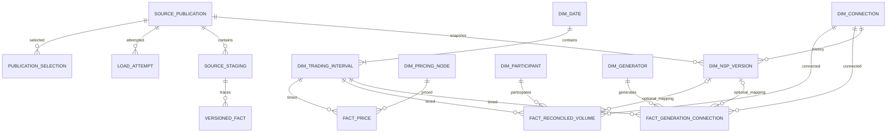
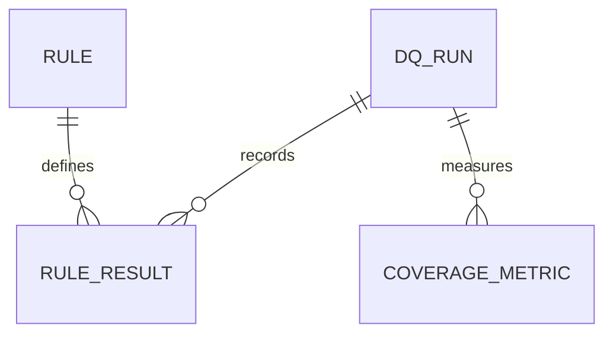

# PostgreSQL schema dictionary

The core warehouse definitions below originated in warehouse and retain the same grains. Later quality and analytical objects are described in [the DQ framework](data_quality_framework.md) and [analytical design](analytics_design.md). Exact source fields are listed in [the source dictionary](data_dictionary.md) and `config/source_schema.json`. continuous-release acceptance is recorded in [historical release validation](release_validation.md).

## continuous-release additive objects

| Object | Grain / purpose |
|---|---|
| metadata.v_source_packaging | One publication; explicit monthly/snapshot/daily-aggregate form, constituent identity and count |
| metadata.v_source_constituent | One official daily constituent of a derived publication; original metadata JSON, date, URL, hash, download/HTTP and final-status fields |
| quality.required_publication | Source + month PK; 36 monthly slots plus retained NSP snapshot; separate from immutable original content baselines |
| analytics.mart_market_daily_rolling_30d | Scope + Zone + local trading date; only complete consecutive 30-date windows expose pooled price, demand and volatility |

These changes use new checksum-tracked migrations. They do not alter core fact keys, rewrite original NSP boundaries or create a new demand fact. The legacy configuration field `analytics.configuration.pilot_months` holds the approved release month array; its name is retained for compatibility, not to limit the release to three months.

## Metadata

| Table | Grain / keys | Meaning |
|---|---|---|
| metadata.schema_migration | SQL path PK | Applied SQL hash and timestamp; a changed applied migration fails verification |
| metadata.source_publication | publication_id PK; unique source_name + SHA-256 | Immutable content identity, source month, filename, size, URL, download/HTTP metadata, unzoned preparation, snapshot date, full manifest JSON and load status/counts |
| metadata.publication_selection | source_name + source_month PK; composite FK to publication | Exactly one selected loaded publication per source/month; updated transactionally |
| metadata.load_attempt | attempt_id PK; publication FK | Running/succeeded/failed attempt, timestamps, duration and failure reason |

The NSP source month is the first day of its snapshot month; the exact snapshot date remains separate. Fact publications use their actual data month. The content identity is source + SHA-256; same-byte aliases remain recorded in the external manifest rather than duplicate content records. Publication timestamps have distinct meanings and are never silently interpreted as one publication instant. Selection is restricted to loaded publications by a trigger.

## Source staging

Every table has `(publication_id, source_row_number)` as its primary key and publication foreign key. COPY assigns the original 1-based data-row ordinal. An advisory lock serialises writers before the shared ordinal sequence is reset for the next file. A rolled-back attempt cannot leave committed staging rows.

| Table | Original columns retained |
|---|---|
| staging.final_energy_price | All four price fields, with original header spelling |
| staging.reconciled_volume | All nine fields including participant, network, flow and local clock label |
| staging.generation_daily | Seven identity/classification/date fields and TP1–TP50, still wide |
| staging.network_supply_point | All 27 NSP fields, including inclusive boundary dates/TPs and metadata |

Original fields are text to preserve source values and distinguish the raw evidence from SQL types. CSV empty fields retain their null semantics. Typed numeric/date conversions and validation occur in SQL. Whole-file raw bytes and their hashes remain outside the database in immutable storage.

## Dimensions

| Table | Identity | Main attributes |
|---|---|---|
| core.dim_date | Local trading_date PK | Year, month, expected 46/48/50 period count |
| core.dim_trading_interval | interval_id PK; unique trading_date + TP and UTC start | UTC/local start/end, endpoint offsets, DST flags, folds, Pacific/Auckland timezone |
| core.dim_pricing_node | pricing_node_id PK; full pricing_poc unique | Independent pricing-node identity, including unmapped nodes |
| core.dim_connection | connection_id PK; POC + network unique | Source connection identity independent of pricing and generator |
| core.dim_participant | participant_id PK; participant code unique | Reconciliation participant, independent of network |
| core.dim_generator | generator_id PK; raw Gen_Code unique | Plant label only; no assumed permanent POC/network/site |
| core.dim_nsp_version | nsp_version_id PK; unique publication + NSP + original start date/TP | Snapshot lineage, source row FK, connection FK, all original metadata JSON, original boundaries, Zone/Island/region/parent fields, UTC validity, explicit boundary status/reason |

Calendar rows are generated only for the approved loaded months; continuous-release spans September 2025 through August 2026. The SQL `core.tp_start` helper converts actual dates referenced by NSP history without loading those historical facts. Calendar generation steps through UTC instants between consecutive NZ local midnights. Repeated local times retain distinct interval keys and folds. DST flags use NZ's 720/780-minute offsets applicable to this release; tests compare every stored interval attribute with the approved Python calendar.

`valid_bounded` requires an ordered UTC range; `valid_open` requires a start and genuinely missing source end; `invalid_boundary` requires null derived boundaries plus a reason. A CHECK prevents null from ambiguously representing invalid and open histories. Original fields always survive. Invalid rows are excluded from temporal mapping and never clamped.

## Physical facts

| Table | Primary key / versioned business grain | Measures and lineage |
|---|---|---|
| core.fact_price | publication + interval + pricing node | Native dollars/MWh numeric(20,8); source row FK |
| core.fact_reconciled_volume | publication + interval + connection + participant + flow | Native kWh numeric(20,6); generated MWh = kWh/1000; original Island/clock label; source row FK; NSP snapshot, nullable NSP version and mapping status |
| core.fact_generation_connection | publication + interval + generator + connection | Native kWh numeric(20,6), generated MWh; original Site/Fuel/Tech; source daily row FK and TP; NSP snapshot, nullable NSP version and mapping status |

Site/fuel/technology are fact-level observed attributes, not extra key columns. A future duplicate at the approved grain raises a uniqueness error rather than disappearing into an expanded key. No second raw demand fact exists. Negative finite measures are retained; NaN and invalid/null required values fail. Numeric precision is sufficient for the pilot; pre-commit native totals checks reject rounding differences and original text remains available if future source precision needs review.

Mapping status is `mapped`, `unmapped` or `ambiguous`. Only one effective NSP candidate permits a mapping FK. The composite NSP FK ties that key to the declared snapshot. Facts retain the snapshot used for mapping, so later NSP selection does not silently reinterpret old facts. Explicit remapping/version policy is needed if the snapshot changes.

## Selected views and indexes

`core.v_selected_price`, `core.v_selected_reconciled_volume`, and `core.v_selected_generation` join the selection register by publication. Multiple physical revisions can coexist while only one revision per source/month is exposed. Volume/generation views present `Unknown` for missing mapped geography; original null attributes remain in NSP history. Price does not receive an arbitrary NSP FK or guessed geography. Node-to-NSP consensus/bridge analytics are deferred.

Primary/unique indexes enforce grains and serve publication-first loads and selected-view access. Each fact has one interval-first join index. NSP has one partial `(publication_id, connection_id, valid_from_utc)` index excluding invalid boundaries. Temporary mapping tables have an interval/connection unique index. There is no partitioning or speculative suite of region/fuel indexes.

## ERD

`SOURCE_STAGING` and `VERSIONED_FACT` are diagram groupings for the physical tables listed above, not extra database tables. Publication lineage applies to all staging/fact tables. Nullable mapping retains Unknown facts and national totals; pricing identity has no forced NSP relationship.

## quality quality schema

Core/staging/metadata definitions above are preserved. The additional quality objects are:

| Object | Grain / purpose |
|---|---|
| quality.rule | One registered SQL rule; code, dimension, severity, target, expected condition, treatment, business implication and blocking/active flags |
| quality.dq_run | One execution; as-of date, timestamps, lineage/population fingerprint, code SHA-256, Git reference, input manifest, status and error |
| quality.rule_result | Run + rule PK; result status, affected unit count, observed JSON, expected value, coverage, diagnostics and immutable rule-definition snapshot |
| quality.coverage_metric | Run + source + month PK; denominator unit, total, known, Unknown, percentage |
| quality.expected_publication | Approved source + month PK; original hash/population/native-total baseline and tolerance |
| quality.v_latest_dq_results | Latest completed or blocked run's rule results and dimensions |
| quality.v_latest_dq_summary | Pass/warn/fail/blocking counts per quality dimension; no weighted score |
| quality.v_latest_coverage | Latest completed or blocked run's monthly measured coverage |

The eight `quality.input_*` views project three physical facts, calendar, NSP and three selected fact views. They allow rollback-only quality fixtures without altering warehouse facts/constraints. Transaction-local profiles support efficient checks and are dropped at completion; they are not persistent analytical marts. SQL functions prepare profiles and return standard PASS/WARN/FAIL payloads. See [DQ framework](data_quality_framework.md) and [register](data_quality_register.md).

Expected publications reference immutable hashes logically rather than via a cascading FK: a missing predecessor must be detectable as a DQ failure. Run results retain the exact rule metadata assessed. Native coverage denominators and Unknown values remain explicit.

## analytical-mart analytics schema

No existing warehouse or quality object is redefined. SQL lives in `sql/04_marts`; see [dependency diagram and refresh contract](analytics_design.md) and [formulas](kpi_dictionary.md).

| Object | Grain / purpose |
|---|---|
| ref_generation_classification | Version + exact raw fuel/technology pair; category, primary/storage role, energy status, evidence, review status, rationale |
| configuration | One pinned configuration: classification version, approved months, expected Zones, fixed 0.99 percentile |
| refresh_run | One attempt; status, timestamps, input manifest/SHA-256, code hash, Git commit, retained DQ run, error |
| current_refresh | Singleton reference to successful atomic cache release |
| _interval_cache | Private scope + Zone + interval PK; unique scope + Zone + UTC start; calendar fields, energy/numerator/denominator/source row counts, classification and geography components |
| _threshold_cache | Private scope + Zone PK; P99, population count, months and observation endpoints |
| refresh_status | Current release plus stale/current flag and retained DQ assessment as-of; diagnostic access allowed when stale |
| _interval_input | Guarded cache projection with price, MW, shares and coverage |
| mart_market_interval / _national / _zone | Scope + Zone + interval, with continuity-gated changes and full-known-Zone spread |
| mart_regional_spread | Interval, represented/expected known Zone counts and conditional spread |
| mart_market_daily / _national / _zone | Scope + Zone + local date; counts/hours, energy components, price distribution and coverage |
| mart_market_monthly | Scope + Zone + selected month; direct energy-weighted price and period metrics |
| mart_market_daily_rolling | Daily grain; previous date, contiguous block, observation/completeness flags and full seven-day metrics |
| mart_price_pressure_threshold | National or known Zone; stored P99 with population and comparison metadata |
| _event_members | Internal flagged interval population with continuity group |
| mart_price_pressure_event | Scope + Zone + event start; stable event_id, UTC/local endpoints, interval count, price/demand/generation/spread/coverage |
| mart_price_event_context | Event plus within-region peak-price rank and refresh/DQ lineage |
| mart_source_quality / mart_quality_results | Retained DQ coverage/rule results joined to current analytical release, with as-of date |

Public product views call `assert_current()`; `input_manifest()` and `input_fingerprint()` implement selected-source/reference/migration identity checks. Private tables are not consumer contracts. All numeric coverage rates are percentages; null denominator produces NULL. Original generation codes remain in core and the versioned reference. Missing source groups are not fabricated as zero activity. National is a distinct analytical scope and must not be added to its constituent Zones.
